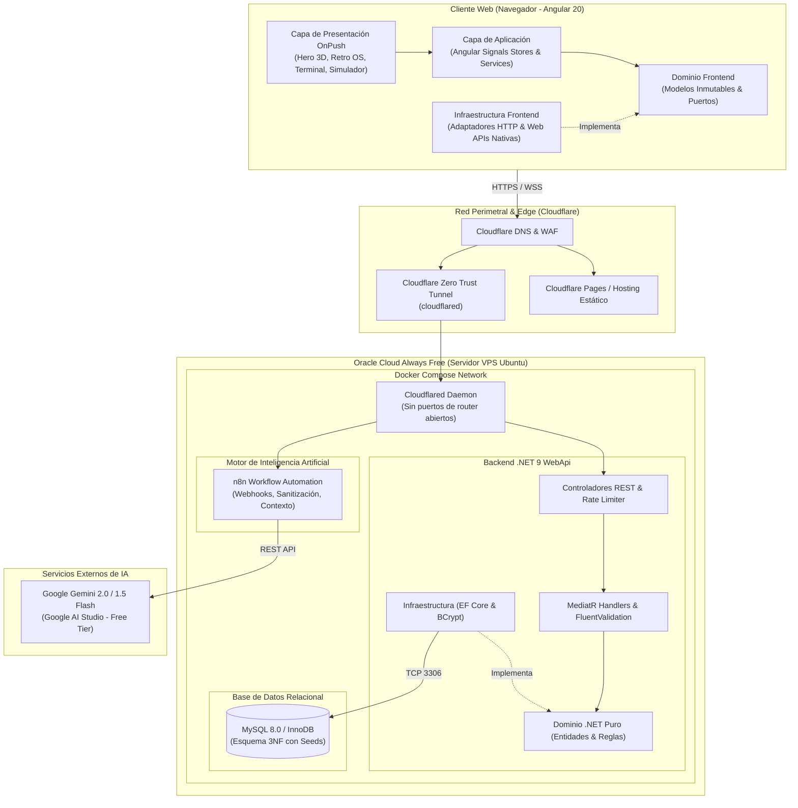

# 01 // VISIÓN GENERAL DE ARQUITECTURA
> *Clean Architecture, Inversión de Dependencias y Principios Ponytail para el Portafolio Interactivo.*

---

## 1. Filosofía Arquitectónica

El proyecto está diseñado bajo los estándares de un **Ingeniero Principal de Software**. No se concibe como un sitio estático desechable, sino como un sistema modular desacoplado capaz de resistir refactorizaciones, cambios de tecnología en la capa de datos o presentación, y escalar horizontal o verticalmente sin fricción.

### Principios Fundamentales:
1. **Regla de Dependencia Estricta**:
   - Las dependencias en el código fuente solo pueden apuntar **hacia adentro**, en dirección a las políticas de negocio de más alto nivel.
   - Tanto en Backend (.NET) como en Frontend (Angular), el núcleo de dominio desconoce frameworks, detalles de persistencia, clientes HTTP o bibliotecas de terceros.
2. **Inversión de Dependencias (DIP)**:
   - Los módulos de alto nivel no dependen de módulos de bajo nivel; ambos dependen de abstracciones (interfaces y puertos).
   - Los adaptadores técnicos (EF Core, MySQL, HttpClient, Web Storage) implementan los contratos definidos en el dominio.
3. **Filosofía Ponytail (Simplicidad Radical & Rendimiento)**:
   - **YAGNI (You Aren't Gonna Need It)**: No construir abstracciones especulativas para requisitos que no existen hoy.
   - **KISS (Keep It Simple, Stupid)**: Priorizar la librería estándar de .NET y las Web APIs nativas del navegador antes de añadir paquetes externos en `npm` o `NuGet`.
   - **Cero Abstracciones Infladas**: Prohibido crear `GenericRepository<T>` inflados con 30 métodos o envolver `DbContext` en un `UnitOfWork` redundante.

---

## 2. Diagrama de Arquitectura Global del Sistema

---

## 3. Desglose de Capas

### A. Capa de Frontend (Hexagonal en Angular 20)
- **Presentation**: Componentes puramente reactivos con `ChangeDetectionStrategy.OnPush`. Separación rigurosa en *Smart Containers* (control de vista y señales) y *Dumb Components* (reciben señales por `input()` y emiten eventos por `output()`).
- **Application**: Stores basados en **Angular Signals** (`signal`, `computed`, `effect`) que administran el estado global y local sin el overhead de bibliotecas pesadas.
- **Domain**: Modelos TypeScript inmutables (`readonly`) e interfaces de puertos (`Port`). Cero imports de `@angular/*`.
- **Infrastructure**: Adaptadores que implementan los puertos consumiendo la API de .NET mediante `HttpClient` o interactuando con Web APIs nativas (`CanvasRenderingContext2D`, `AudioContext`, `localStorage`).

### B. Capa de Backend (Clean Architecture .NET 8/9)
- **Domain**: Entidades de negocio ricas con encapsulación, Value Objects y contratos de persistencia específicos. Independiente de ASP.NET Core y EF Core.
- **Application**: Casos de uso modelados con CQRS (`IRequest<T>` y `IRequestHandler<T, R>`), pipeline behaviors para validación automática con FluentValidation.
- **Infrastructure**: Persistencia con Entity Framework Core sobre MySQL, configuración mediante Fluent API (`IEntityTypeConfiguration<T>`), migraciones declarativas y generación de JWTs.
- **WebApi**: Controladores livianos que delegan a MediatR, middleware global de excepciones conforme al estándar RFC 7807 (`ProblemDetails`) y políticas de Rate Limiting por IP.

### C. Capa de Automatización e IA (n8n + Gemini)
- Orquestación visual y sin código de flujos complejos.
- Sanitización de entradas para proteger cuotas de API gratuitas.
- Memoria de conversación por sesión (`sessionId`).
- Inyección de la base de conocimiento estructurada de Bryan Baño.

### D. Capa de Infraestructura Cloud (Oracle Cloud + Cloudflare)
- Instancia Compute en Oracle Cloud Always Free ejecutando Docker Compose.
- **Túnel de Cloudflare (Cloudflare Tunnel)**: Elimina la necesidad de IP pública estática o abrir puertos en el firewall/security list de Oracle. El contenedor `cloudflared` establece una conexión segura saliente con la red Edge de Cloudflare con cifrado TLS automático.

---

## 4. Reglas de Calidad y Mantenibilidad

1. **Límites de Líneas por Archivo**: Se respeta una modularidad balanceada: componentes de 80 a 180 líneas (máximo 280), handlers de 40 a 90 líneas (máximo 160).
2. **Revisión Continua Ponytail**: Toda adición de código se somete a escrutinio para eliminar dependencias redundantes y mantener la huella de memoria al mínimo.
3. **Respeto a la Accesibilidad**: Cumplimiento de WCAG AAA en contrastes de texto y respeto al estándar `prefers-reduced-motion` en todas las animaciones y secuencias 3D.
