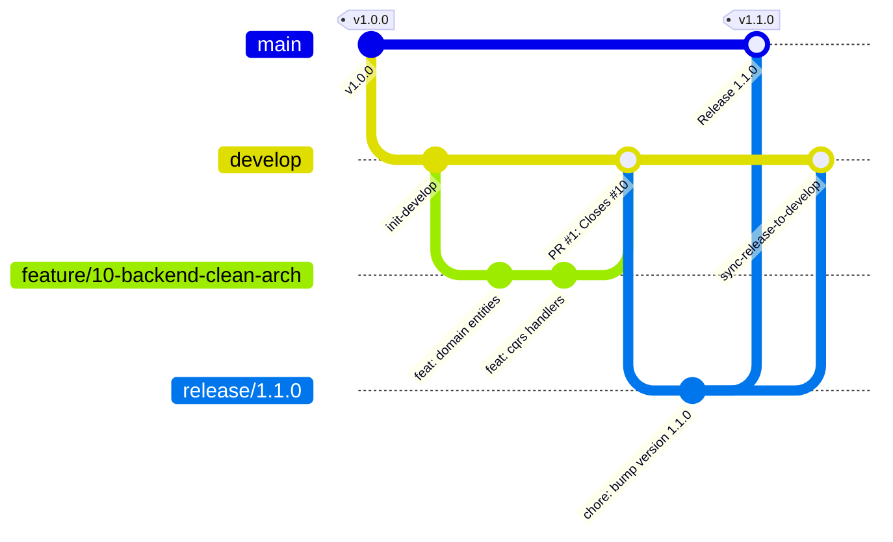

# 05 // GITFLOW EMPRESARIAL & CONVENCIONES PARA FORGEJO
> *Estándar de Ramificación, Commits Convencionales, Ciclo de Pull Requests y Protección de Ramas en Forgejo.*

---

## 1. Reglas de Oro del GitFlow Empresarial

Para garantizar un estándar de ingeniería de software enterprise en el repositorio alojado en **Forgejo** ([`https://git.bryan-bano.com/`](https://git.bryan-bano.com/)):

1. **NUNCA hacer `git push` directo a `main` ni a `develop`**:
   - Ambas ramas son permanentes y están protegidas en Forgejo.
   - Todo cambio entra estrictamente mediante **Pull Request (PR)** revisado y con checks de CI en verde.
2. **Flujo Centrado en `develop`**:
   - Todo desarrollo de nuevas funcionalidades (`feature/*`), solución de errores (`bugfix/*`) y mantenimiento (`chore/*`) nace a partir de `develop` y tiene como destino de merge a `develop`.
3. **Paso a `main` Exclusivo desde `develop`**:
   - Solo código probado, estabilizado y aprobado en `develop` puede ascender a `main`. La integración se realiza mediante ramas de corte de versión (`release/x.y.z`) autorizadas.
4. **Issue Primero (Issue-Driven Development)**:
   - No se escribe código sin un **Issue** previo creado en Forgejo con su descripción, milestone y etiquetas asociadas.
5. **Cierre Automático de Trazabilidad**:
   - Todo Pull Request debe vincular explícitamente el issue correspondiente mediante la palabra clave `Closes #<id>`.

---

## 2. Convención de Ramas de Trabajo



### Tabla de Convenciones de Ramas:

| Prefijo de Rama | Origen | Destino de PR | Propósito | Formato |
|---|---|---|---|---|
| `feature/<id>-slug` | `develop` | `develop` | Nueva funcionalidad o módulo | `feature/12-login-jwt` |
| `bugfix/<id>-slug` | `develop` | `develop` | Corrección de error para próximo release | `bugfix/15-fix-canvas-leak` |
| `chore/<id>-slug` | `develop` | `develop` | Tareas de CI/CD, configuración, docs, refactor | `chore/20-setup-act-runner` |
| `release/<x.y.z>` | `develop` | `main` | Preparación de corte de versión hacia producción | `release/1.1.0` |
| `hotfix/<id>-slug` | `main` | `main` y `develop` | Parche urgente por fallo crítico en producción | `hotfix/22-fix-cors-api` |

### Comandos de Creación de Rama:
```bash
# 1. Asegurar paridad con develop remoto
git switch develop
git pull --ff-only origin develop

# 2. Crear rama de trabajo vinculada al Issue #12
git switch -c feature/12-autenticacion-jwt
```

---

## 3. Convención de Mensajes de Commit

Los mensajes de commit deben ser claros, concisos y autoexplicativos:

### Reglas:
1. **Longitud**: La primera línea (asunto) debe tener entre **10 y 72 caracteres**.
2. **Formato Convencional**: `<tipo>(<alcance opcional>): <descripción clara en imperativo>`.
3. **Tipos Permitidos**:
   - `feat`: Nueva característica o endpoint.
   - `fix`: Corrección de bug o fallo de renderizado.
   - `refactor`: Refactorización de código sin alterar funcionalidad externa.
   - `chore`: Tareas de build, dependencias, CI/CD o configuración.
   - `docs`: Modificación exclusiva de documentación o bóveda.
   - `test`: Adición o corrección de pruebas unitarias o de integración.
4. **Mensajes Prohibidos (Rechazados por CI)**:
   - Prohibido mensajes genéricos como `wip`, `update`, `fix`, `cambios`, `pruebas`, `minor` o puntos sueltos.

### Ejemplos Válidos:
- ✅ `feat(backend): agregar handler CQRS para registro en libro de visitas` (68 chars)
- ✅ `fix(canvas): corregir limpieza de memoria en ngOnDestroy del buscador` (67 chars)
- ✅ `chore(devops): registrar act_runner en el servidor Rocky Linux` (61 chars)

---

## 4. Estándar de Pull Requests en Forgejo

Al abrir un Pull Request en `https://git.bryan-bano.com/`:

1. **Título del PR**:
   - `[PRJ-<ID>] <tipo>: <descripción concisa>` (ej. `[#12] feat: implementar autenticación JWT en WebApi`).
2. **Cuerpo del PR (Plantilla Requerida)**:
   ```markdown
   ## Descripción del Cambio
   Breve explicación técnica de lo implementado.

   ## Trazabilidad de Issue
   Closes #12

   ## Tipo de Cambio
   - [x] Nueva funcionalidad (feat)
   - [ ] Corrección de bug (fix)
   - [ ] Refactorización o mantenimiento (chore)

   ## Verificación y Pruebas
   - [x] Compilación exitosa en local (`npm run build` o `dotnet build`)
   - [x] Ejecución del skill `ponytail-review` (cero sobreingeniería)
   ```

---

## 5. Configuración de Ramas Protegidas en la Interfaz de Forgejo

Para blindar el repositorio empresarialmente en Forgejo:

1. Ingresar en el repositorio en [`https://git.bryan-bano.com/`](https://git.bryan-bano.com/) -> **Settings (Configuración)** -> **Branches (Ramas)**.
2. En **Branch Protection Rules (Reglas de Protección)** para `main` y `develop`:
   - [x] **Enable branch protection** (Habilitar protección).
   - [x] **Disable push** (Deshabilitar push directo: solo se puede mergear vía Pull Request).
   - [x] **Require approval** (Exigir aprobación antes de merge).
   - [x] **Require status checks to pass** (Exigir que las acciones de CI/CD pasen en verde).
   - [x] **Block merge on rejected reviews** (Bloquear merge si hay cambios solicitados).
