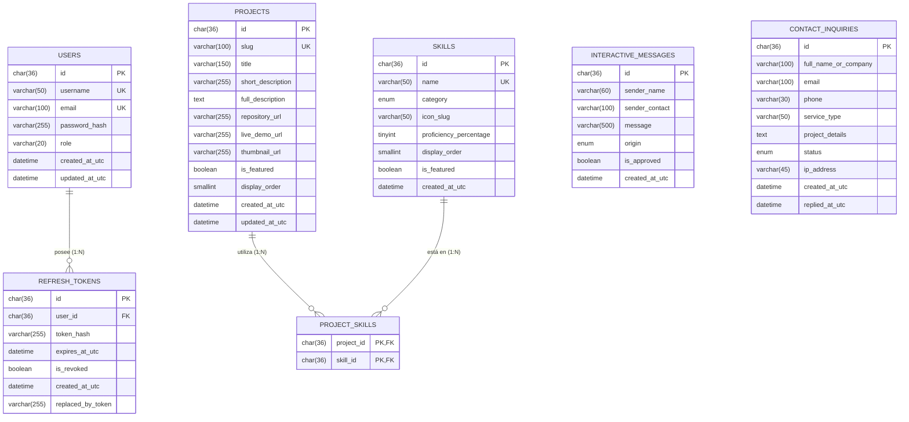

# 02 // ESTADO ACTUAL — BASE DE DATOS MYSQL
> *Esquema Relacional en Tercera Forma Normal (3NF), Optimización de Índices y Datos Semilla.*

---

## 1. Ficha Técnica de la Base de Datos

- **Archivo Fuente**: [`database/schema.sql`](file:///home/bryan/Projects/PORTFOLIO/database/schema.sql)
- **Base de Datos**: `portfolio_db`
- **Motor**: MySQL 8.0+ / MariaDB 10.4+ (InnoDB Engine)
- **Charset & Collation**: `utf8mb4` / `utf8mb4_unicode_ci` (compatibilidad total con símbolos, tildes y caracteres especiales)
- **Diseño**: Minimalista, normalizado en **Tercera Forma Normal (3NF)** y guiado por la filosofía Ponytail (cero sobreingeniería relacional).

---

## 2. Diagrama Entidad-Relación (ERD)

---

## 3. Justificación y Propósito de Cada Tabla

### 1. `users` (Autenticación y RBAC del Propietario)
- **Propósito**: Almacena las credenciales administrativas de Bryan para el futuro backoffice.
- **Decisión Ponytail**: Se evita crear una maraña de tablas `roles`, `permissions` y `user_roles`. Al existir solo dos roles (`Admin` y `Visitor`), una columna `role VARCHAR(20)` es la solución más limpia y eficiente.

### 2. `refresh_tokens` (Rotación Segura de Sesiones JWT)
- **Propósito**: Permite mantener la sesión activa de Bryan sin emitir JWTs de larga duración.
- **Seguridad**: Soporta invalidación en cadena (`replaced_by_token`, `is_revoked`) con borrado en cascada ligado al usuario.

### 3. `skills` (Catálogo de Habilidades Técnicas)
- **Propósito**: Administradas vía CRUD por Bryan. Se categorizan en `Backend`, `Frontend`, `Database`, `DevOps` y `Architecture`.
- **Uso**: Consumidas por el frontend y por la terminal interactiva (`cat skills.json` o `fetch skills`).

### 4. `projects` (Proyectos del Portafolio)
- **Propósito**: Catálogo completo de proyectos destacados y secundarios.
- **Ventaja**: Permite a Bryan agregar o editar proyectos en producción sin tener que volver a compilar o redesplegar el frontend. Incluye `slug` amigable para URLs directas y comandos en terminal.

### 5. `project_skills` (Tabla Intermedia N:M)
- **Propósito**: Resuelve la relación muchos a muchos entre Proyectos y Habilidades sin duplicar cadenas de texto en arrays no normalizados.

### 6. `interactive_messages` (Libro de Visitas / Guestbook)
- **Propósito**: Almacena las firmas dejadas por reclutadores y visitantes técnicos desde el comando `guestbook sign "mensaje"` de la terminal Linux interactiva o el probador de API en vivo.

### 7. `contact_inquiries` (Consultas Técnicas B2B y Propuestas)
- **Propósito**: Almacena leads comerciales privados enviados desde el formulario web de contacto.
- **Seguridad**: Totalmente aislada del libro de visitas público. Incluye trazabilidad de IP (`ip_address`), estado (`New`, `Read`, `Replied`, `Archived`) y fecha de respuesta.

---

## 4. Estado de Migración y Datos Semilla (Seeds)

El archivo `database/schema.sql` ya incluye los datos semilla listos para ejecución inmediata:
- **Usuario Admin Inicial**: UUID `11111111-1111-1111-1111-111111111111`, username `bryan`, con contraseña hasheada.
- **Habilidades Base**: .NET 8/9, Clean Architecture & CQRS, Angular & Signals, MySQL / EF Core, Docker & CI/CD.
- **Proyecto Semilla**: Portafolio Profesional Interactivo vinculado a las habilidades clave.
- **Mensaje de Bienvenida**: Registro inicial de `Kernel Bot` en el libro de visitas.
- **Consulta de Contacto de Prueba**: Solicitud simulada de modernización de arquitectura.
