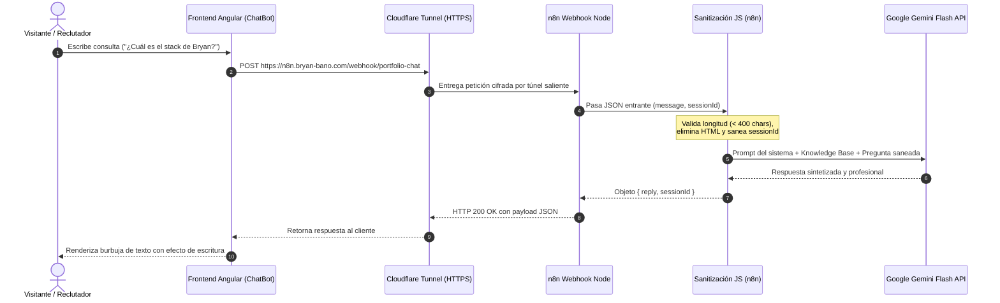

# 03 // ESTADO ACTUAL — AUTOMATIZACIÓN E INTELIGENCIA ARTIFICIAL (n8n + GEMINI)
> *Orquestación de Agentes, Ingress con Cloudflare Tunnel, Sanitización y Base de Conocimiento.*

---

## 1. Visión y Propósito del Agente de IA

En lugar de incrustar widgets comerciales de terceros o sobrecargar el backend con llamadas monolíticas a modelos LLM, el proyecto utiliza una arquitectura de **automatización desacoplada con n8n**, un modelo **Google Gemini (capa gratuita de alta velocidad)** y un **túnel cifrado de Cloudflare**.

### Ventajas de esta Elección:
1. **Costo Cero ($0/mes)**: Aprovecha la capa gratuita de Google AI Studio (15 RPM y 1,500 peticiones diarias gratuitas de Gemini 2.0 / 1.5 Flash).
2. **Cero Puertos Expuestos**: La comunicación entre el servidor y el cliente web se realiza a través de un túnel Zero Trust (`cloudflared`), sin abrir puertos en el firewall de Oracle Cloud.
3. **Mantenibilidad Sin Despliegues**: El comportamiento del agente, los prompts y los flujos pueden ajustarse visualmente en n8n sin tener que compilar ni redesplegar el frontend o backend.

---

## 2. Inventario de Archivos en `automation/n8n/`

| Archivo | Ubicación | Descripción |
|---|---|---|
| **docker-compose.yml** | [`automation/n8n/docker-compose.yml`](file:///home/bryan/Projects/PORTFOLIO/automation/n8n/docker-compose.yml) | Definición multicontenedor con `n8n` y el daemon del túnel `cloudflared`. |
| **portfolio-chat-workflow.json** | [`automation/n8n/portfolio-chat-workflow.json`](file:///home/bryan/Projects/PORTFOLIO/automation/n8n/portfolio-chat-workflow.json) | Definición exportada del flujo de trabajo n8n con nodo Webhook, sanitización en JavaScript, nodo Gemini y nodo de respuesta. |
| **bryan-knowledge-base.md** | [`automation/n8n/bryan-knowledge-base.md`](file:///home/bryan/Projects/PORTFOLIO/automation/n8n/bryan-knowledge-base.md) | Documento estructurado con la identidad, filosofía, proyectos reales y directrices del agente virtual. |
| **SETUP-GUIDE.md** | [`automation/n8n/SETUP-GUIDE.md`](file:///home/bryan/Projects/PORTFOLIO/automation/n8n/SETUP-GUIDE.md) | Guía paso a paso para la puesta en marcha local y en el VPS de Oracle Cloud. |

---

## 3. Flujo de Procesamiento del Agente Conversacional

---

## 4. Endpoints y Tokens en el Frontend

El frontend en Angular se comunica con la automatización a través de dos Injection Tokens tipados:
- **`CHAT_WEBHOOK_URL`**: Ubicado en [`src/app/core/tokens/chat-config.token.ts`](file:///home/bryan/Projects/PORTFOLIO/src/frontend/src/app/core/tokens/chat-config.token.ts).
  - Valor predeterminado: `https://n8n.bryan-bano.com/webhook/portfolio-chat`
- **`SECURITY_AGENT_WEBHOOK_URL`**: Ubicado en [`src/app/core/tokens/security-agent-config.token.ts`](file:///home/bryan/Projects/PORTFOLIO/src/frontend/src/app/core/tokens/security-agent-config.token.ts).
  - Valor predeterminado: `https://n8n.bryan-bano.com/webhook/security-agent`

---

## 5. Medidas de Protección y Seguridad Implementadas

1. **Límite de Longitud**: Todo mensaje entrante se corta a un máximo de 400 caracteres para preservar la cuota gratuita de tokens de Gemini.
2. **Eliminación de Inyecciones**: Se eliminan etiquetas HTML/Scripts mediante regex antes de ser pasadas al LLM.
3. **Rate Limiting**: El servicio frontend [`SecurityAgentService`](file:///home/bryan/Projects/PORTFOLIO/src/frontend/src/app/services/security-agent.service.ts) ya contempla el control de código HTTP 429 para informar al usuario de límites por ventana de tiempo (ej. máximo 10 peticiones cada 5 minutos).
