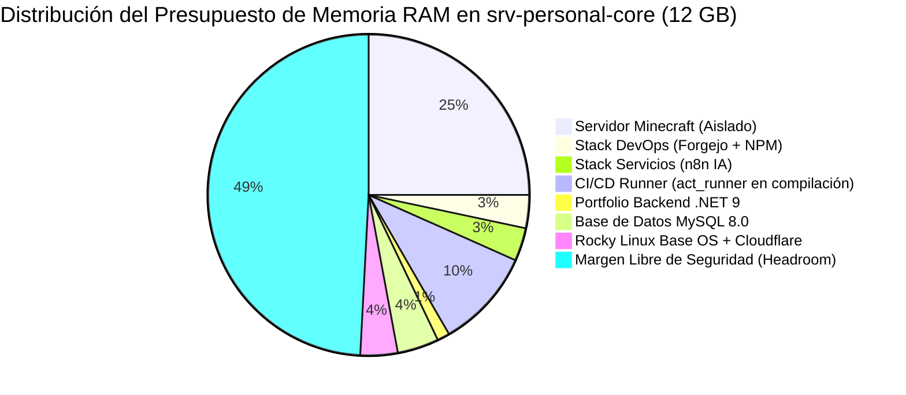

# 01 // INFRAESTRUCTURA REAL — SERVIDORES ORACLE CLOUD & CAPACIDAD
> *Inventario de Instancias Compute, Especificaciones Hardware, Presupuesto de Memoria y Topología.*

---

## 1. Inventario de Instancias OCI (Región us-ashburn-1)

De acuerdo con la consola oficial de Oracle Cloud Infrastructure (Always Free Ampere A1), Bryan dispone de dos instancias activas en la misma VCN (`10.0.0.0/16`):

| Instancia | Estado | IP Pública | IP Privada | Shape / Arquitectura | OCPUs | Memoria RAM | Dominio (AD/FD) | Propósito |
|---|---|---|---|---|---|---|---|---|
| **`srv-personal-core`** | `Running` | **`132.145.165.230`** | `10.0.0.107` | **VM.Standard.A1.Flex (ARM64)** | **2 OCPU** | **12 GB** | AD-2 / FD-2 | **Host Principal DevOps, Forgejo, n8n y Portafolio** |
| **`joeman-hato-erp`** | `Running` | `193.122.145.10` | `10.0.0.117` | VM.Standard.A1.Flex (ARM64) | 2 OCPU | 6 GB | AD-2 / FD-2 | Servidor ERP / Proyectos Hermanos |

> [!NOTE]
> **Balance del Tenant Always Free**:
> - OCPUs asignadas: 2 + 2 = **4 OCPUs** (100% de la cuota gratuita máxima de ARM Ampere).
> - Memoria asignada: 12 GB + 6 GB = **18 GB** (de los 24 GB disponibles en Always Free; restan 6 GB de margen para futuras ampliaciones si fuera necesario).

---

## 2. Especificaciones de `srv-personal-core` (Host de este Proyecto)

- **Nombre en OCI**: `srv-personal-core`
- **IP Pública**: `132.145.165.230`
- **Usuario SSH**: `rocky`
- **Sistema Operativo**: **Rocky Linux 9** (aarch64 / ARM64)
- **Procesador**: 2 núcleos físicos Ampere Altra ARM64
- **Memoria RAM**: **12.0 GB**
- **Acceso SSH**:
  ```bash
  ssh -i ~/ssh-key-2026-09-15.key rocky@132.145.165.230
  ```

---

## 3. Presupuesto y Asignación de Memoria RAM (12 GB Totales)

Con **12 GB de RAM**, el servidor cuenta con holgura suficiente para operar todos los servicios existentes y los nuevos componentes del portafolio **sin riesgo de saturación, throttling de CPU ni swapping**:



### Desglose Detallado del Consumo de Memoria:

| Componente / Servicio | Ubicación | Consumo Estimado | Estado |
|---|---|---|---|
| **Rocky Linux OS + Kernel + cloudflared** | Sistema Base | ~450 MB | Activo |
| **Servidor Minecraft (Aislado)** | `~/minecraft-server` | ~2.5 – 3.0 GB | Activo (No interferir) |
| **Forgejo Git Server** | `~/devops/forgejo` | ~250 MB | Activo (`git.bryan-bano.com`) |
| **Nginx Proxy Manager (`npm`)** | `~/devops/npm` | ~150 MB | Activo (Proxy interno) |
| **n8n Automation** | `~/services/n8n` | ~350 – 400 MB | Activo (`n8n.bryan-bano.com`) |
| **act_runner (Forgejo CI/CD)** | `~/devops/runner-data` | ~100 MB reposo / ~1.2 GB build | Por desplegar |
| **Base de Datos MySQL 8.0** | Docker `portfolio_mysql` | ~450 – 550 MB | Por desplegar |
| **Backend .NET 9 WebApi** | Docker / k3s Pod | ~120 – 180 MB | Por desplegar |
| **Memoria Libre para el Sistema** | Buffer / Caché | **~5.5 GB Libres** | **Margen de seguridad óptimo** |

---

## 4. Regla Técnica Obligatoria: Arquitectura ARM64 (aarch64)

Al tratarse de procesadores **Ampere Altra ARM64**:
1. **Imágenes Docker**: Todas las imágenes base utilizadas en los Dockerfiles y runners deben contar con soporte nativo `linux/arm64`:
   - `.NET 9 SDK / Runtime`: `mcr.microsoft.com/dotnet/sdk:9.0` y `mcr.microsoft.com/dotnet/aspnet:9.0` (soporte multi-arch oficial completo).
   - `Node.js`: `node:22-bookworm` (soporte multi-arch oficial completo).
   - `Forgejo & act_runner`: Imágenes oficiales `code.forgejo.org/forgejo/*` (soporte nativo arm64).
   - `MySQL / MariaDB`: `mysql:8.0` o `mariadb:10.11` (imágenes oficiales multi-arch).
2. **Rendimiento**: Los 2 núcleos Ampere entregan rendimiento sostenido predecible sin degradación térmica ni sobrecarga de virtualización.

---

## 5. Mapa del Sistema de Archivos en el Servidor (`/home/rocky`)

```
/home/rocky/
├── app.ini                         <- Configuración de runtime de Forgejo
├── devops/                         <- Stack DevOps Central (Git & Reverse Proxy)
│   ├── docker-compose.yml          <- Orquestación de Forgejo y Nginx Proxy Manager
│   ├── forgejo/                    <- Datos persistentes y repositorios git
│   └── npm/                        <- Nginx Proxy Manager (certificados y proxies internos)
├── services/                       <- Servicios y Automatizaciones de Producción
│   └── n8n/                        <- Orquestador de flujos de IA y webhooks
└── minecraft-server/               <- Servidor lúdico aislado (IGNORADO del stack empresarial)
```
