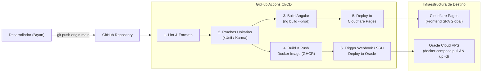

# 03 // PIPELINE DE CI/CD & DESPLIEGUE CONTINUO
> *Automatización con GitHub Actions, Cloudflare Pages y Despliegue en Oracle Cloud.*

---

## 1. Estrategia Global de CI/CD

El objetivo del pipeline de integración y entrega continua es permitir que cualquier cambio probado en la rama `main` o `develop` se compile, valide y despliegue automáticamente en producción sin intervención manual propensa a errores.

### Flujo de Dos Vías:
1. **Frontend**: Compilación de Angular 20 y publicación instantánea en **Cloudflare Pages** (distribución CDN global de latencia ultra-baja).
2. **Backend & Automatización**: Construcción de la imagen Docker de .NET 9, publicación en **GitHub Container Registry (GHCR)** y actualización del contenedor en el servidor de **Oracle Cloud VPS** vía SSH automatizado.

---

## 2. Diagrama del Pipeline de Despliegue



---

## 3. Ejemplo de Workflow: Frontend en Cloudflare Pages (`.github/workflows/deploy-frontend.yml`)

```yaml
name: Deploy Frontend to Cloudflare Pages

on:
  push:
    branches:
      - main
    paths:
      - 'src/frontend/**'

jobs:
  build-and-deploy:
    runs-on: ubuntu-latest
    steps:
      - name: Checkout Code
        uses: actions/checkout@v4

      - name: Setup Node.js 22
        uses: actions/setup-node@v4
        with:
          node-version: 22
          cache: 'npm'
          cache-dependency-path: src/frontend/package-lock.json

      - name: Install Dependencies
        run: |
          cd src/frontend
          npm ci

      - name: Build Angular Project
        run: |
          cd src/frontend
          npm run build -- --configuration production

      - name: Deploy to Cloudflare Pages
        uses: cloudflare/pages-action@v1
        with:
          apiToken: ${{ secrets.CLOUDFLARE_API_TOKEN }}
          accountId: ${{ secrets.CLOUDFLARE_ACCOUNT_ID }}
          projectName: 'portfolio-bryan'
          directory: 'src/frontend/dist/portfolio-frontend/browser'
          gitHubToken: ${{ secrets.GITHUB_TOKEN }}
```

---

## 4. Ejemplo de Workflow: Backend en Oracle Cloud (`.github/workflows/deploy-backend.yml`)

```yaml
name: Deploy Backend to Oracle Cloud

on:
  push:
    branches:
      - main
    paths:
      - 'src/backend/**'
      - 'database/**'

jobs:
  deploy-backend:
    runs-on: ubuntu-latest
    steps:
      - name: Checkout Repository
        uses: actions/checkout@v4

      - name: Deploy on Oracle Cloud VPS via SSH
        uses: appleboy/ssh-action@v1.0.3
        with:
          host: ${{ secrets.ORACLE_VPS_HOST }}
          username: ${{ secrets.ORACLE_VPS_USER }}
          key: ${{ secrets.ORACLE_VPS_SSH_KEY }}
          script: |
            cd /opt/portfolio
            git pull origin main
            cd automation/docker
            docker compose pull backend
            docker compose up -d --no-deps --build backend
            docker image prune -f
```
