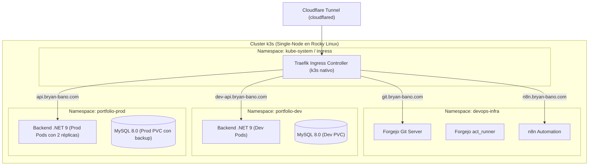

# 05 // ORQUESTACIÓN CON CONTENEDORES LIVIANOS — K3S VS DOCKER COMPOSE
> *Evaluación de k3s (Lightweight Kubernetes), Namespaces de Desarrollo y Producción, y Despliegue Automatizado.*

---

## 1. ¿Por qué Contenedores Livianos con k3s?

**k3s** es una distribución de Kubernetes certificada por la CNCF (Cloud Native Computing Foundation), diseñada por Rancher/SUSE específicamente para servidores con recursos limitados, entornos Edge y desarrollo.

### Comparativa: k3s vs. Docker Compose en el Servidor Rocky Linux

| Criterio | Docker Compose | k3s (Lightweight Kubernetes) | Veredicto para el Proyecto |
|---|---|---|---|
| **Consumo de Memoria** | Muy bajo (~150 MB de Docker daemon) | Bajo (~400-512 MB de control-plane) | Ambos viables en el VPS de Oracle Cloud. |
| **Separación de Ambientes** | Varios archivos `docker-compose.*.yml` o proyectos aislados. | **Namespaces nativos (`portfolio-dev`, `portfolio-prod`)**. | **k3s es superior** para simular un entorno enterprise real. |
| **Despliegues Sin Caídas (Zero-Downtime)** | Manual / Scripting complejo. | **Rolling Updates & Health Probes nativas**. | **k3s es superior**. |
| **Curva de Mantenimiento** | Mínima, sintaxis simple. | Requiere manejo de manifiestos YAML de K8s (`kubectl`). | Docker Compose es más rápido; k3s aporta **mayor valor curricular enterprise**. |
| **Gestión de Secretos** | Archivos `.env` en disco. | `Kubernetes Secrets` cifrados en etcd/sqlite. | **k3s es superior en seguridad**. |

---

## 2. Arquitectura de Despliegue con k3s en el VPS de Oracle

Si se adopta k3s en el servidor Rocky Linux (`132.145.165.230`), la topología se organiza por **Namespaces**:



---

## 3. Instalación Rápida de k3s en Rocky Linux

k3s se instala como un servicio `systemd` único sin ensuciar el sistema:

```bash
# Instalación con Traefik deshabilitado si ya usas Nginx Proxy Manager / Docker:
curl -sfL https://get.k3s.io | sh -

# Verificar estado del nodo:
sudo kubectl get nodes
```

Para coexistir pacíficamente con Docker mientras se migran servicios:
- k3s puede utilizar el runtime de contenedores Docker nativo mediante el flag `--docker`:
  ```bash
  curl -sfL https://get.k3s.io | sh -s - --docker
  ```

---

## 4. Manifiesto K8s de Ejemplo para el Backend .NET (`k8s/backend-deployment.yaml`)

```yaml
apiVersion: apps/v1
kind: Deployment
metadata:
  name: portfolio-backend
  namespace: portfolio-prod
  labels:
    app: portfolio-backend
spec:
  replicas: 2
  strategy:
    type: RollingUpdate
    rollingUpdate:
      maxSurge: 1
      maxUnavailable: 0
  selector:
    matchLabels:
      app: portfolio-backend
  template:
    metadata:
      labels:
        app: portfolio-backend
    spec:
      containers:
        - name: webapi
          image: git.bryan-bano.com/bryan/portfolio-backend:latest
          imagePullPolicy: Always
          ports:
            - containerPort: 5000
          env:
            - name: ASPNETCORE_ENVIRONMENT
              value: "Production"
            - name: ConnectionStrings__DefaultConnection
              valueFrom:
                secretKeyRef:
                  name: db-credentials
                  key: connection-string
          resources:
            limits:
              memory: "256Mi"
              cpu: "300m"
            requests:
              memory: "128Mi"
              cpu: "100m"
          livenessProbe:
            httpGet:
              path: /api/v1/interactive/ping
              port: 5000
            initialDelaySeconds: 10
            periodSeconds: 15
---
apiVersion: v1
kind: Service
metadata:
  name: portfolio-backend-svc
  namespace: portfolio-prod
spec:
  selector:
    app: portfolio-backend
  ports:
    - protocol: TCP
      port: 80
      targetPort: 5000
```

---

## 5. Estrategia de Transición DevOps Recomendada

1. **Etapa Inmediata**: Mantener Forgejo, NPM y n8n en `~/devops/` y `~/services/` vía Docker Compose para máxima estabilidad.
2. **Etapa Intermedia**: Desplegar el Backend .NET y MySQL en Docker Compose junto a un `act_runner` de Forgejo.
3. **Etapa Avanzada**: Si Bryan desea certificar competencias en Kubernetes en su portafolio, inicializar **k3s** para orquestar los microservicios y ambientes (`portfolio-dev` y `portfolio-prod`) con despliegues *Zero-Downtime* disparados por Forgejo Actions.
